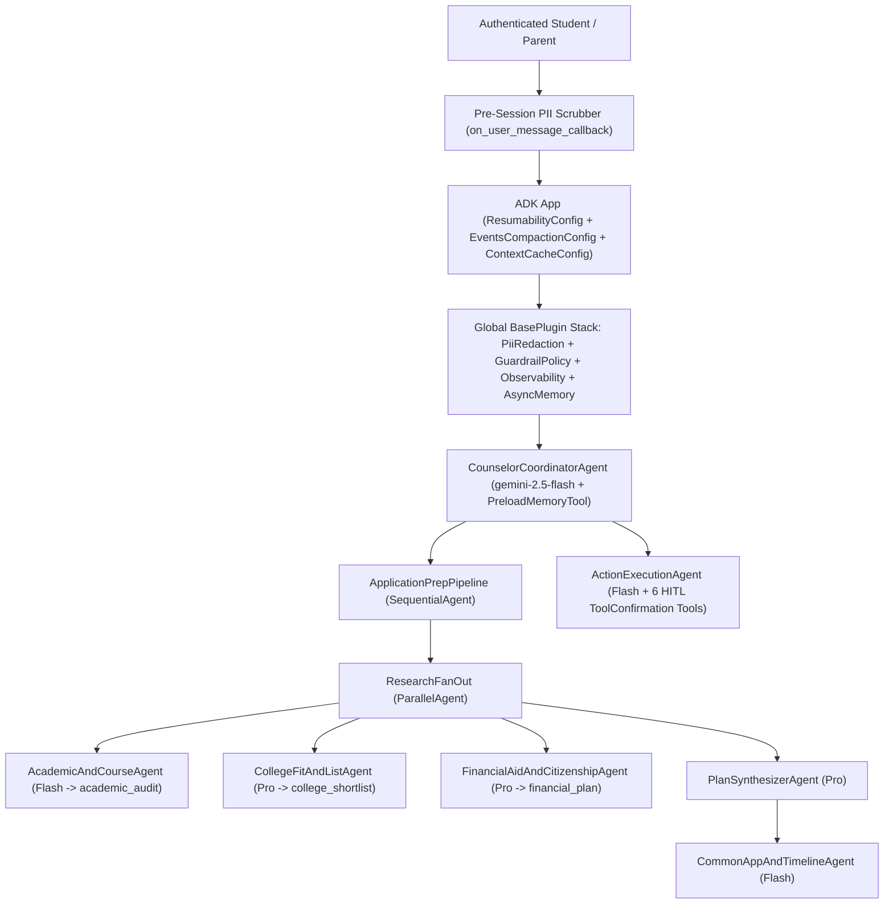

# PathFinder AI — College Application Advisor Agent (Class of 2028)

A multi-agent, privacy-first **Google ADK (Python)** advisor guiding high school students and parents through the **2027–2028 U.S. college application cycle (Fall 2028 entry)** — covering course rigor, Reach/Target/Safety matching, 4-year Cost of Attendance, merit and need-based aid, **non-U.S. citizen guidance (H-4, I-485 pending, Green Card, F-1)**, Common App execution, and key deadlines.

## Architecture



## Quick Start (Local Testing)

```bash
# 1. Create a virtual environment and install dependencies
python3 -m venv .venv
source .venv/bin/activate
pip install -e ".[dev]"

# 2. Configure non-secret environment variables (never commit .env)
cp .env.example .env

# 3. Run offline unit, PII, guardrail, HITL, ADK plugin, and repo hygiene tests
make test
make hygiene

# 4. Launch the interactive ADK Web UI locally (with persistent SQLite sessions)
make adk-web

# 5. Run the golden ADK evaluation suite (requires Vertex AI or API key)
make eval
```

## Deploy to Google Cloud Run (Terraform + `agent-starter-pack` Layout)

```bash
# 1. Build and push the container image to Artifact Registry
export PROJECT_ID=<YOUR_GCP_PROJECT_ID>
export REGION=us-central1
export IMAGE_URI=${REGION}-docker.pkg.dev/${PROJECT_ID}/pathfinder/advisor:latest

gcloud builds submit --tag "${IMAGE_URI}" .

# 2. Provision Cloud Run, Cloud SQL, Firestore, Secret Manager, and Cloud DLP via Terraform
cd deployment/terraform
terraform init
terraform apply \
  -var="project_id=${PROJECT_ID}" \
  -var="region=${REGION}" \
  -var="container_image=${IMAGE_URI}"

# 3. Access the authenticated Cloud Run Web UI safely from your browser
gcloud run services proxy pathfinder-college-advisor --region="${REGION}" --port=8080
# Open http://localhost:8080
```

## 19-Criterion AgentOps Rubric Evidence Table (95 / 95)

| Category | Criterion | Implementing File(s) |
| :--- | :--- | :--- |
| **1. Tool & Interface Design** | Comprehensive Tool Docstrings | `app/tools/academic_tools.py`, `college_tools.py`, `finance_tools.py`, `timeline_tools.py` |
| | Descriptive Naming | Verb-noun tools (`evaluate_senior_course_rigor`, `lookup_noncitizen_aid_policy`, `lock_early_decision_choice`, etc.) |
| | Explicit JSON Schemas | `app/tools/schemas.py` (Pydantic v2 output models for every tool, enums, provenance & 180-day staleness) |
| | Guided Error Handling | `ToolErrorResponse` & async-aware `@guided_tool_error_handler` in `app/tools/schemas.py` |
| **2. Context & Memory** | Robust System Instructions | `app/prompts/constitution.py` |
| | History Compaction | `EventsCompactionConfig` & `ContextCacheConfig` in `app/agent.py` |
| | Persistent Session State | `server.py` (`DatabaseSessionService` / Cloud SQL) & Firestore `StudentMemoryStore` in `app/plugins/memory.py` |
| | Async Memory Operations | `AsyncMemoryPlugin` (`add_session_to_memory` + tracked `asyncio.create_task`) in `app/plugins/memory.py` |
| **3. Orchestration & Logic** | Multi-Agent Patterns | `SequentialAgent` + `ParallelAgent` (`{academic_audit?}`, `{college_shortlist?}`, `{financial_plan?}`) in `app/sub_agents/pipeline.py` |
| | Strategic Model Routing | `gemini-2.5-flash` (routing/academic/timeline/actions) vs. `gemini-2.5-pro` (college fit/finance/synthesis) |
| | Guardrails & Policy Plugins | `GuardrailPolicyPlugin(BasePlugin)` in `app/plugins/guardrails.py` |
| | Human-in-the-Loop Hooks | `ResumabilityConfig` in `app/agent.py` + 6 HITL `request_confirmation` tools with before/after diffs in `app/tools/timeline_tools.py` |
| **4. Observability & Tracing** | Structured JSON Logging | `structlog` JSON + Cloud Trace correlation + fail-closed DLP in `app/plugins/observability.py` |
| | Intent vs. Outcome Capture | Agent + Tool `before_*` / `after_*` callbacks in `app/plugins/observability.py` |
| | Distributed Tracing | OpenTelemetry `TracerProvider` + `PiiScrubbingSpanProcessor` in `app/plugins/observability.py` |
| | PII Redaction | 5-choke-point Cloud DLP + regex scrubber (`on_user_message_callback`, callbacks, logs, OTel, memory) in `app/security/pii_redactor.py` & `app/plugins/pii_plugin.py` |
| **5. Infrastructure & CI/CD** | Automated Evaluation Suites | `evals/college_advisor.evalset.json`, `evals/test_config.json`, `evals/test_agent_evals.py`, `.github/workflows/ci.yml` |
| | Infrastructure as Code | `Dockerfile`, `server.py`, `deployment/terraform/main.tf`, `variables.tf`, `outputs.tf` |
| | Secure Secret Management | `app/security/secrets.py` + Terraform `google_secret_manager_secret` (`SESSION_DB_URL` & optional API key) |
